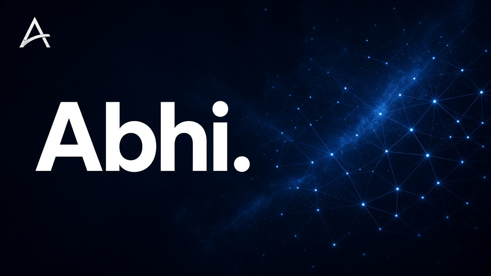

<!-- Profile README: visual-first. Personality + pulse — not a CV. -->

  

<h1 align="center">Hey, I'm Abhi.</h1>

  

  <b>Builder · researcher · badminton after hours</b> 
  Tucson · <a href="https://isjustabhi.com">isjustabhi.com</a> · <a href="https://medium.com/@isjustabhi">Medium</a>

  
  
  
  
  

 

  

 

I'm **Abhi** — research software, AI systems, and a court when the laptop can wait.  
No resume dump here. Just the vibe, the pulse, and a door to the work.

 

  

  
  
  
  

 

## pulse

  
  &nbsp;
  

  

  

  

  <picture>
    <source media="(prefers-color-scheme: dark)" srcset="https://raw.githubusercontent.com/isjustabhi/isjustabhi/output/github-contribution-grid-snake-dark.svg" />
    <source media="(prefers-color-scheme: light)" srcset="https://raw.githubusercontent.com/isjustabhi/isjustabhi/output/github-contribution-grid-snake.svg" />
    
  </picture>

cached widgets

 

  
  

  

 

  
  &nbsp;
  

  <i>Just Abhi. Building things, chasing ideas, and smashing shuttlecocks.</i>

  

