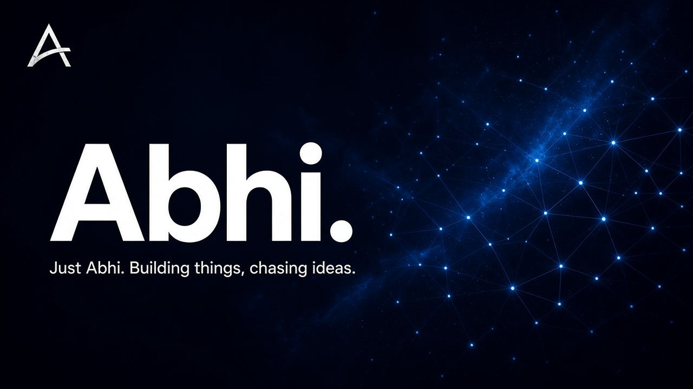

<!-- Profile README: cinematic, personality-first — not a CV. -->

  

<h1 align="center">Hey, I'm Abhi.</h1>

  

  <b>Builder · researcher · badminton after hours</b> 
  Tucson ·
  <a href="https://isjustabhi.com">isjustabhi.com</a> ·
  <a href="https://medium.com/@isjustabhi">Medium</a> ·
  <a href="https://calendly.com/isjustabhi">Book time</a>

  
  
  
  
  

 

  

 

  Research software. AI systems that have to hold up. 
  No resume dump here — just the vibe, the pulse, and a door to the work.

 

  

  
  
  

 

## pulse

  
  &nbsp;
  

  

  

  <picture>
    <source media="(prefers-color-scheme: dark)" srcset="https://raw.githubusercontent.com/isjustabhi/isjustabhi/output/github-contribution-grid-snake-dark.svg" />
    <source media="(prefers-color-scheme: light)" srcset="https://raw.githubusercontent.com/isjustabhi/isjustabhi/output/github-contribution-grid-snake.svg" />
    
  </picture>

offline widgets

 

  
  

  

 

  
  &nbsp;
  
  &nbsp;
  

  <i>Just Abhi. Building things, chasing ideas, and smashing shuttlecocks.</i>

  

