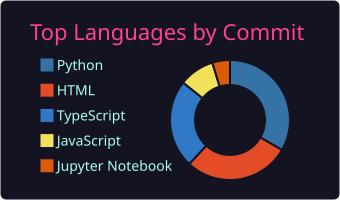

<!--
  Profile README for github.com/isjustabhi
  Personality + live stats — not a CV.
-->

<p align="center">
  
</p>

<p align="center">
  
</p>

<p align="center">
  <a href="https://isjustabhi.com"></a>
  <a href="https://medium.com/@isjustabhi"></a>
  <a href="https://www.linkedin.com/in/isjustabhi"></a>
  <a href="https://scholar.google.com/citations?user=nhEzRmAAAAAJ&hl=en"></a>
  <a href="mailto:abhiramn@arizona.edu"></a>
</p>

---

### hey

I'm **Abhi** — Abhiram Varma Nandimandalam when a form wants the long version.  
I live in Tucson. I build research software that has to hold up. When the laptop can wait, I'm on a badminton court.

Home base: **[isjustabhi.com](https://isjustabhi.com)** · journal: **[Medium @isjustabhi](https://medium.com/@isjustabhi)**

---

### right now

Scientific Analyst — Data, AI & Bioinformatics at [LSCH](https://psychology.arizona.edu/person/abhiram-nandimandalam), University of Arizona.  
Shiny tools a PI can click. Synthetic survey experiments. Literature pipelines that scale. Retrieval when chat isn't enough.

A few things I'm proud of (artifacts, not a resume):

| | |
| :--- | :--- |
| **[LLM-HyPZ](https://arxiv.org/abs/2509.00647)** | IEEE ICDMW 2025 · hardware CVEs · MITHRA Lab |
| **PersonaeAI** | Claude + ANES personas · human-vs-synthetic survey research |
| **Rural Health Kiosk** | Capstone prototype · voice / text / avatar · not clinical |
| **Lab software** | [systematic-review-processor](https://github.com/isjustabhi/systematic-review-processor) · AVA · sensitivity Shiny |

Everything else lives on the site. Private repos stay private.

---

### github pulse

<p align="center">
  
  
</p>

<p align="center">
  
</p>

<p align="center">
  
</p>

<p align="center">
  
</p>

<details>
<summary>Offline snapshot (if a widget is down)</summary>
<br/>
<p align="center">
  
  
</p>
<p align="center">
  
</p>
</details>

---

### find me

```text
isjustabhi.com
medium.com/@isjustabhi
linkedin.com/in/isjustabhi
github.com/isjustabhi
abhiramn@arizona.edu
```

<p align="center">
  <i>Just Abhi. Building things, chasing ideas, and smashing shuttlecocks.</i>
</p>
